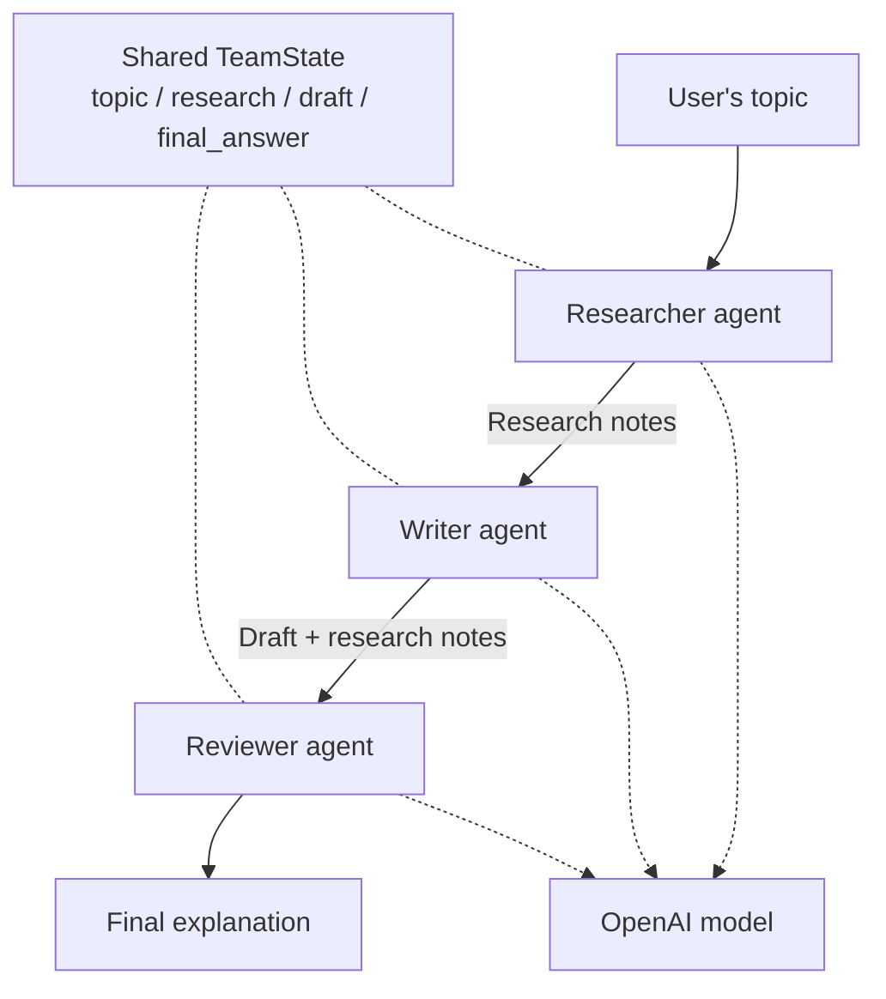
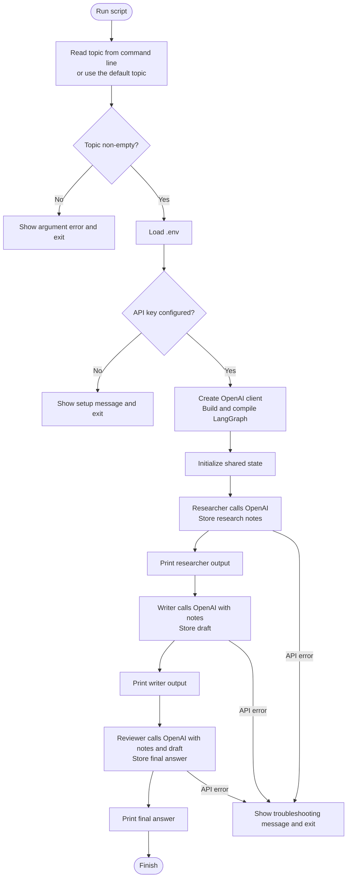

# Multi-Agent System Flow Diagrams

These diagrams describe the application in `self-learning-mas.py`.
View this file in a Markdown viewer that supports Mermaid to render the diagrams.

## Program Architecture

Three role-specific agents share one OpenAI model client. LangGraph passes their
outputs through `TeamState`.

## Program Execution

This follows the application's `main()` entry point.

The agents run sequentially, not in parallel. Each makes a separate model call;
shared state supplies the context between calls. The researcher uses the model's
existing knowledge, not web search. The key check detects missing configuration,
not whether OpenAI will accept the key.